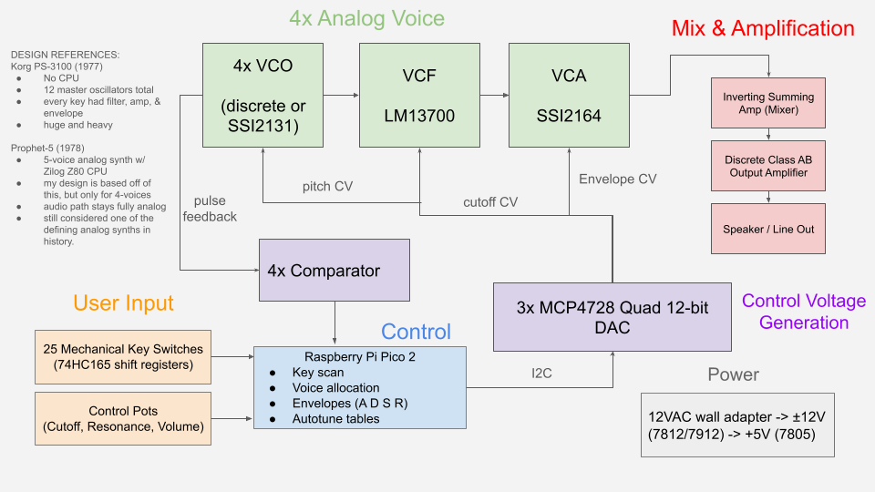

# Polyphonic Analog Synthesizer

> A 4-voice, fully polyphonic analog synthesizer, based on the Prophet-5 synthesizer from the 1970s.
Each voice will be designed to have its own voltage controlled oscillator, filter, and amplifier, with tone shaping via via envelopes. A microcontroller (RP2350) handles voice allocation and tuning tables, with audio generation remaining entirely analog.

## Contact

**Name:** Fleur Maravilla Gatchalian  
**Virginia Tech Email:** fleurgatch06@vt.edu
**LinkedIn:** https://www.linkedin.com/in/fleurgatch06/
**Github:** https://github.com/fleurgatch06

## Project Overview

**Goal:** Design and build a 4-voice, fully polyphonic analog synthesizer. Each voice has its own oscillator, filter, amplifier, and envelope.

A polyphonic synthesizer can play several notes at once, with each note shaped independently. In this design every voice is a complete analog signal chain:

 - **VCO** (voltage-controlled oscillator): generates the initial waveform. Its pitch follows a control voltage that sets the pitch, which includes voltage. Outputs a pulse feedback that is fed back into the RP2350 to set pitches via closed-loop feedback.
- **VCF** (voltage-controlled filter): a low-pass filter that shapes the tone's brightness.
- **VCA** (voltage-controlled amplifier): shapes the loudness of each note with its own Attack, Decay, Sustain, Release (ADSR) envelope.

These analog voices are mixed together and driven to a speaker. The Raspberry Pi Pico 2 reads the keyboard and determines which voice plays each note. It sends each voice the control voltages through DACs and automatically retunes the analog oscillators as they drift with temperature and other environmental factors. 

It is important to note that the Raspberry Pi Pico 2 does not generate any audio signals; every sound comes from the analog voice circuits. This design is based off of the Sequential Circuits Prophet-5 (1978), which used a Zilog Z80 CPU to control analog voices in the same manner.

### Background

This project builds on a prior a 24-voice analog synthesizer that I designed for a ENGE 1216 team project:

- **Oscillators:** one LM324 relaxation oscillator per key, tuned with resistors and pots.
- **Supply:** a single 9 V supply with a buffered virtual ground.
- **Output:** an inverting summing amplifier into an LM386 output stage.

It had full polyphony, but had limits to its design:

- One oscillator per key doesn't scale.
- There were no envelopes, so notes were simply on or off.
- The summing amplifier was quiet.
- There was little control over pitch or sound character.

The move to voltage-controlled voices, with a VCA and envelope per voice, fixes all four. 

### Design Targets

| Target | Value |
|---|---|
| Voices | 4, with plans to expand further |
| Pitch range | ≥ 4 octaves |
| Tuning accuracy after autotune | within ±5 cents |
| Key-to-sound latency | < 5 ms |
| Power | ±12 V  |

## What I Hope to Learn

**Analog design**
- The inner workings of the synthesizers that shaped modern music: 1970s and 1980s audio circuit design
- VCO, VCF, and VCA design: exponential converters, oscillator cores, OTA filters, VCAs
- Environmental compensation: temperature drift and component tolerance (tempco resistors, matched transistor pairs, trimming)

**Embedded systems**
- Generating precise control voltages with DACs
- Real-time voice allocation
- Closed-loop autotuning of analog oscillators

**PCB design**
- KiCad mixed-signal layout, which invovles keeping analog and digital grounds and signals apart
- SMD soldering and board assembly

**General**
- Design tradeoffs: discrete vs. IC, analog vs. digital
- Budgeting and sourcing components

## Design and Implementation

The system has five parts:

1. **User input:** 25 mechanical key switches (2 octaves), read through 74HC165 shift registers, with control pots for cutoff, resonance, and volume.
2. **Control:** a Raspberry Pi Pico 2 (RP2350) that handles key scanning, voice allocation, envelope generation (ADSR), and autotune tables.
3. **Control Voltage generation:** three MCP4728 quad 12-bit DACs (12 channels: pitch, cutoff, and envelope for each of the 4 voices).
4. **Analog voices (×4):** VCO, VCF, VCA.
5. **Mix and amplification:** an inverting summing amplifier (mixer), a discrete class-AB output amplifier, and a speaker and line out.

Power comes from a 12 VAC wall adapter, regulated to ±12 V (7812/7912) and +5 V (7805).

### Voice Signal Chain

**VCO: Will be build both discrete and with ICs**
- **Discrete**, built to learn how the exponential converter works:
  - An op-amp summer scales the 1 V/oct pitch CV down to about 18 mV per octave (V_T * ln2).
  - A matched NPN pair (SSM2212, or DMMT3904W as a budget option) turns that op-amp output into a collector current that doubles every octave.
  - The collector current charges a timing capacitor, and a comparator and a JFET resets the capacitor at a threshold, which produces a sawtooth waveform.
- **Temperature compensation:** the thermal voltage V_T = kT/q drifts about +3300 ppm/C, which shifts the octave scale. A +3300 ppm/°C tempco resistor (Panasonic ERA-V33J102V) in the summer's feedback aims to cancels most of that pitch drift.
- **Later voices will use the Sound Semiconductor SSI2131 VCO IC**, which has built-in temperature compensation and stable tracking.

**VCF: LM13700 OTA low-pass filter**
- A 2-pole (12 dB/octave) Operational Transconductance Amplifier (OTA) low-pass filter so that each note's brightness can be shaped independently.
- **Cutoff control:** cutoff is proportional to the OTA's bias current. A small exponential converter on the cutoff control input makes equal voltage steps produce equal pitch intervals, with better waveform fidelity at low cutoff frequencies.
- **Resonance/Q/Emphasis:** amplitude boost around a filter's cutoff frequency, set by feedback around the filter. The channels of an additional SSI2164 control it, so one panel knob could set the resonance on all four voices.

**VCA: SSI2164 quad-VCA**
- One SSI2164 provides four VCAs, with one per voice.
- Exponential (dB-linear), −33 mV/dB with low control feedthrough so waveform envelopes can fade smoothly.

**Mixer and output**
- An inverting summing amplifier will be used to mix the four voices. 
- A discrete class-AB amplifier drives the speaker, which will also have a line output. A class D amplifier may be considered in the future.

### Control and Firmware (Raspberry Pi Pico 2)

- **Key scan:** reads the 25 keys through 74HC165 shift registers on 3 pins. This will also debounce each key.
- **Voice allocation:** assigns each new note to a free voice and reuses a voice that just played the same pitch. When all four voices are busy, it will acquire the quietest one, fading it out over about 1 ms or so.
- **Envelopes (ADSR):** calculates an Attack, Decay, Sustain, Release envelope for each voice and sends it to that voice's VCA through the DAC.
- **Autotune:** each VCO's pulse output passes through a comparator (LM393) to the Pich, which measures the VCO's frequency with the RP2350's digital pins. The Pico will sweep each voice and store a per-note table of the exact DAC code for every note. This should correct for oscillator drift and nonlinearities within the DAC.

### Design References

- **Korg PS-3100 (1977):** fully polyphonic with no CPU and had 12 master oscillators in total, with each divided down into every octave. Every key was designed to have its own filter, amplifier, and envelope. It was huge and heavy. That approach is similar to the previous LM324-array-based design that this project moves away from.
- **Sequential Circuits Prophet-5 (1978):** 5-voice analog synthesizer controlled by a Zilog Z80 CPU. The Z80 scanned the keys, assigned voices, generated control voltages, and autotuned the oscillators, while the audio path stayed fully analog. Today, it's still considered one of the defining analog synthesizers. This design follows the same model, but with only 4 voices.

Document the design of your project as it develops.

This may include:

- Block diagrams
- Circuit schematics
- PCB designs
- CAD models
- Software architecture
- Hardware selection
- Calculations
- Testing methods

Explain major design decisions and why you made them.

## Bill of Materials
*Will be updated soon to reflect a more convenient, single-supplier BOM.

| Item | Quantity | Estimated Cost | Link |
|---|---:|---:|---|
| Raspberry Pi Pico 2 (RP2350) | 1 | $5.00 | [Adafruit](https://www.adafruit.com/product/6006) |
| MCP4728 quad 12-bit DAC breakout | 3 | $22.50 | [Adafruit](https://www.adafruit.com/product/4470) |
| LM393 dual comparator (autotune) | 2 | $1.20 | [TI](https://www.ti.com/product/LM393) |
| SSM2212 precision matched NPN pair | 1 | $12.11 | [LCSC](https://www.lcsc.com/product-detail/C207512.html) |
| DMMT3904W dual NPN (budget pairs, filter expo converters) | 10 | $1.60 | [LCSC](https://www.lcsc.com/product-detail/C155305.html) |
| Panasonic ERA-V33J102V 1 kΩ +3300 ppm/°C tempco resistor | 10 | $8.00 | [DigiKey](https://www.digikey.com/en/products/detail/panasonic-electronic-components/ERA-V33J102V/526840) |
| TL074H low-drift quad op-amp | 4 | $4.00 | [TI](https://www.ti.com/product/tl074h) |
| Discrete VCO core parts (transistors, J111 JFETs, C0G/polystyrene timing caps) | 1 lot | $8.00 | DigiKey |
| SSI2131 VCO IC (4 + 1 spare) | 5 | $26.25 | [Amplified Parts](https://www.amplifiedparts.com/products/integrated-circuit-ssi2131-vco-sound-semiconductor) |
| SSI2164 quad VCA IC (VCAs, resonance control, spare) | 3 | $14.85 | [Amplified Parts](https://www.amplifiedparts.com/products/integrated-circuit-ssi2164-quad-vca-sound-semiconductor) |
| LM13700 dual OTA, SOIC (filters, learning VCA) | 8 | $7.12 | [LCSC](https://www.lcsc.com/product-detail/C174050.html) |
| SMD-to-DIP adapter boards (SOT-363, SOIC-8, SOIC-16) | 25 | $14.00 | Amazon |
| C0G 3.9 nF 1% timing capacitors | 10 | $3.00 | DigiKey |
| TL074 quad op-amp (CV scaling, mixer, buffers) | 10 | $6.00 | [TI](https://www.ti.com/product/TL074) |
| Multi-turn trimmer potentiometers | 15 | $9.00 | DigiKey / Amazon |
| Panel potentiometers + knobs | 8 | $12.00 | DigiKey / Amazon |
| MX-style linear key switches (25 + spares) | 35 | $8.05 | [Milktooth](https://milktooth.com/products/switches/milky-yellow-pro) |
| Blank MX keycaps (white/black) | 1 set | $12.00 | Amazon |
| 74HC165 shift registers + pull-up resistor networks | 4 + 4 | $4.00 | [TI](https://www.ti.com/product/SN74HC165) |
| 12 VAC 1 A wall adapter | 1 | $12.00 | DigiKey |
| 7812 / 7912 / 7805 regulators, rectifiers, filter capacitors | 1 lot | $6.00 | DigiKey |
| Audio/CV jacks | 1 lot | $4.00 | DigiKey |
| JLCPCB 2-layer PCBs, incl. shipping (spring) | 2 designs * 5 boards | $40.00 | [JLCPCB](https://jlcpcb.com) |
| MCP4728 bare chips for the PCB (spring) | 3 | $5.01 | [LCSC](https://www.lcsc.com/product-detail/C627341.html) |

**Estimated Total Cost:** $245.69 (around \$270 with shipping/tax)

Basic passives (resistors, capacitors, wire, breadboards) are sources from local hobby kits or stock within the AMP Lab.

## Timeline and Milestones

| Milestone | Target Date | Status |
|---|---|---|
| Project proposal presented and approved | Oct 30, 2026 | Complete |
| Order parts; simulate expo converter + VCO core; firmware skeleton structure| November 2026 | Not Started |
| Discrete voice(s) on breadboard (first playable voice) | November 2026 | Not Started |
| IC voices, filters, voice allocation, autotune | December 2026 | Not Started |
| 4-voice breadboard demo , or however many voice may be implemented at that time| December 2026 | Not Started |
| KiCad schematic + PCB layout | Winter break 2026-27 | Not Started |
| PCB fabrication + SMD assembly and bring-up | January to February 2027 | Not Started |
| Enclosure + finished instrument | February to March 2027 | Not Started |

## Progress Log

### 2026-10-30

Presented the project proposal to the AMP Lab. The proposal covered background, the 4-voice design choices and block diagram, learning goals, the bill of materials (around $246), and the timeline.

### 2026-11-02

The proposal was approved, and This repository was crated and the README was written. Next up: finalize the parts order, simulate initial schematic, and start the Pico 2 firmware skeleton structure, which involves key scan and DAC writes.

## Project Files

Block diagram is currently included in the repository. More folders will be added as work progresses, which will include the files below:

- Source code
- KiCad files
- Schematics
- PCB layouts
- CAD files
- Datasheets
- Test results
- Documentation

## Useful Links

**Datasheets**
- [SSI2131 VCO datasheet](https://www.soundsemiconductor.com/downloads/ssi2131datasheet.pdf) (Sound Semiconductor)
- [SSI2164 quad VCA datasheet](https://www.soundsemiconductor.com/downloads/ssi2164datasheet.pdf) (Sound Semiconductor)
- [LM13700 dual OTA](https://www.ti.com/product/LM13700) (Texas Instruments)
- [MCP4728 quad 12-bit DAC datasheet](https://www.microchip.com/content/dam/mchp/documents/OTH/ProductDocuments/DataSheets/22187E.pdf) (Microchip)
- [SSM2212 matched NPN pair](https://www.analog.com/en/products/ssm2212.html) (Analog Devices)
- [RP2350 product brief](https://pip-assets.raspberrypi.com/categories/1214-rp2350/documents/RP-008374-DS-1-rp2350-product-brief.pdf) (Raspberry Pi)
- [KOA LT73 tempco resistor datasheet](https://www.koaspeer.com/pdfs/LT73.pdf) (alternative tempco)

**Design references**
- [Prophet-5 (Wikipedia)](https://en.wikipedia.org/wiki/Prophet-5)
- [Korg PS-3100 (Vintage Synth Explorer)](https://www.vintagesynth.com/korg/ps-3100)
- [Designing a Eurorack vintage VCA with the LM13700 (Electric Druid)](https://electricdruid.net/design-a-eurorack-vintage-vca-with-the-lm13700/)